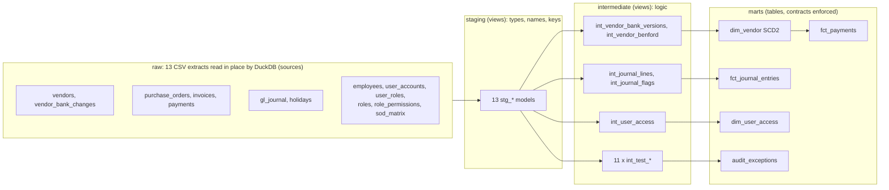
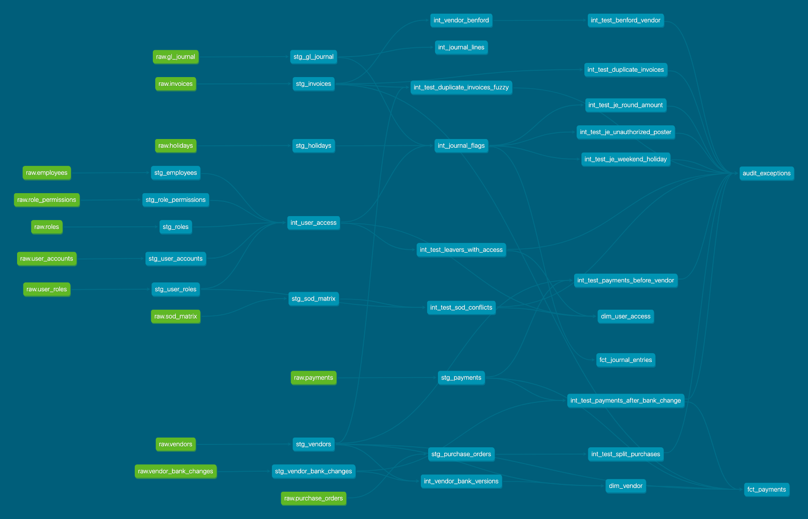

# audit-data-warehouse

A dbt and DuckDB project that turns raw ERP and access-control extracts into audit-ready dimensions,
facts and one `audit_exceptions` table. Eleven full-population tests run on top of tested, typed,
contract-enforced models.

The data is synthetic. It comes from my [audit-analytics-recipes](https://github.com/UtkuFidan/audit-analytics-recipes) repository.

## Why I built this

I lead internal audit data analytics. The SQL recipes in my other repository answer "what would the
test look like". They do not answer the question a reviewer asks next: can I rebuild your numbers,
and where does each one come from? A folder of scripts run by hand does not survive that question.

So this repository takes the same tests and puts them in a warehouse. One command rebuilds
everything from the raw files, the inputs are tested before any audit logic runs, and the lineage
graph shows the path from an exception back to a source file. The ten tests ported from the recipes
produce the same counts as the recipes, which is how I checked the port.

## Architecture



Lineage graph from `dbt docs` (green nodes are sources, blue nodes are models):



### One raw layer

The raw layer is the extract files in `raw_extracts/`. dbt-duckdb reads each CSV in place through
`external_location` on the source definition, so there are no seeds and no second copy of the data
inside the database. Every column is read as text; the staging models own all casts. `RAW_DIR`
points the project at a different folder, which is how `make dirty` swaps in the defective extracts.
In production the same sources would point at parquet files or an ingestion schema.

## Model catalogue

| Layer | Model | Grain | Purpose |
|---|---|---|---|
| staging | 13 `stg_*` models | one row per source row | Explicit casts, `*_id` / `*_date` / `*_amount` naming, keys and relationships tested |
| intermediate | `int_journal_lines` | journal and side | Debit and credit legs, so balance is testable |
| intermediate | `int_journal_flags` | journal | Manual, weekend, holiday, round-amount and poster-permission flags, shared by the mart and the journal tests |
| intermediate | `int_vendor_bank_versions` | vendor and bank version | SCD2 versions from the bank-change log |
| intermediate | `int_vendor_benford` | vendor | First-digit chi-square, p-value and MAD |
| intermediate | `int_user_access` | user | HR record, roles, privilege and posting rights |
| intermediate | `int_test_*` (eleven) | exception | One model per full-population test |
| mart | `dim_vendor` | vendor and bank version | SCD2 with surrogate key, `valid_from`, exclusive `valid_to`, `is_current` |
| mart | `fct_payments` | payment | Vendor version on file at payment date, IBAN match, amount mismatch, after-bank-change flag |
| mart | `fct_journal_entries` | journal | Journal control flags |
| mart | `dim_user_access` | user | Roles, privileged flag, SoD conflict flag, leaver-with-access flag |
| mart | `audit_exceptions` | exception | Standard schema: `test_id`, `entity`, `risk`, `evidence`, `detected_at` |

`dim_vendor` is a modelled SCD2 and not a dbt snapshot. The bank-change log already holds the full
history, so the dimension is rebuilt deterministically on every run, and a payment joins to the
version valid on its date (`valid_from <= date < valid_to`).

### Tests in audit_exceptions

| test_id | Risk | Logic |
|---|---|---|
| `dup_invoice_exact` | Double payment | Same vendor, invoice number and amount; later copies flagged |
| `dup_invoice_fuzzy` | Double payment | Same amount, dates within 7 days, same vendor or vendor names with Jaro-Winkler 0.92 or more after normalisation; exact duplicates excluded |
| `split_purchase` | Approval-limit avoidance | POs at 70-100% of the 10,000 limit, same requester and vendor within 7 days, sum over limit |
| `bank_change_payment` | Payment diversion fraud | Payment to the new IBAN within 14 days of a bank-detail change |
| `payment_before_vendor` | Vendor master control bypass | Payment dated before the vendor record was created |
| `sod_conflict` | Segregation of duties | User holds both roles of a pair in the SoD matrix |
| `leaver_active_account` | Unauthorised access | Account ACTIVE although the HR leave date has passed |
| `je_round_amount` | Management override | Manual journal of 5,000 or more that is a multiple of 1,000 |
| `je_weekend_holiday` | Management override | Manual journal posted on a Saturday, Sunday or listed holiday |
| `je_unauthorized_poster` | Unauthorised access | Manual journal posted by a user with no `post_journal` permission |
| `benford_vendor` | Fabricated amounts | Vendor with 40 or more invoices whose first digits reject Benford's law at p < 0.001 |

The Benford test is plain SQL. For an even number of degrees of freedom the chi-square survival
function has a closed form, and the nine first digits give eight, so `macros/chi2_sf_df8.sql`
computes the p-value without a statistics library. A singular test checks the macro against the
textbook critical values (15.507, 20.090 and 26.124 for 0.05, 0.01 and 0.001).

`payment_before_vendor` was not in the recipe set. It came up while building the SCD2 join, when
five payments had no vendor version on file, so it became a test.

Thresholds are dbt vars in `dbt_project.yml` (`approval_limit`, `round_min_amount`,
`fuzzy_name_similarity`, `benford_alpha` and so on), so a change is a reviewed diff and not an
edit inside a query.

## Data quality

1. Generic tests on every layer: `unique`, `not_null`, `relationships` and `accepted_values` guard
   keys, foreign keys and enumerations.
2. Custom generic tests in `tests/generic/`: `positive_amount`, `date_within_period` (inside the
   fiscal year and matching the booked `YYYY-MM` period) and `journal_balanced` (debits equal credits
   per journal).
3. Model contracts. All five marts set `contract: {enforced: true}` with declared column types, so a
   schema change breaks the build and not a downstream report.
4. Source freshness, measured against `as_of_date` (below).
5. A dirty variant of the extracts injects six defects and the tests catch all of them; see
   [docs/dirty_data.md](docs/dirty_data.md).

Test inventory on the clean data: 51 `not_null`, 17 `unique`, 14 `relationships`, 7
`accepted_values`, 6 `positive_amount`, 4 `unique_combination_of_columns`, 2 `date_within_period`,
1 `journal_balanced` and 1 singular test, 103 in total.

### Freshness against the audit cut-off

`dbt source freshness` normally compares the newest record to the wall clock. On a frozen FY2025
extract that check is either always stale or has thresholds so loose it proves nothing. I override
dbt's `collect_freshness` macro (`macros/collect_freshness.sql`) so the reference time is the
`as_of_date` var, 2025-12-31 by default. Invoices, payments and the journal warn when their newest
record is more than 14 days before the cut-off and error after 45.

```bash
dbt source freshness                                   # passes: newest records are 29 Dec and 31 Dec
dbt source freshness --vars '{as_of_date: "2026-03-01"}'   # all three sources error as stale
```

The same var drives the leaver test, so the cut-off is set in one place.

## Results

Real output of `make build` (dbt-core 1.12.6, dbt-duckdb 1.11.1):

```text
Done. PASS=137 WARN=0 ERROR=0 SKIP=0 NO-OP=0 REUSED=0 TOTAL=137
(29 views, 5 tables, 103 data tests)
```

Dirty run (`make dirty`): 92 of 103 tests pass, 11 fail, covering all six injected defects.

Contents of `marts.audit_exceptions`, also in [reports/exceptions_summary.md](reports/exceptions_summary.md):

| test_id | records tested | exceptions |
|---|---:|---:|
| `split_purchase` | 4,069 POs | 67 |
| `bank_change_payment` | 4,117 payments | 40 |
| `dup_invoice_exact` | 4,317 invoices | 25 |
| `je_round_amount` | 1,164 manual journals | 25 |
| `je_weekend_holiday` | 1,164 manual journals | 23 |
| `dup_invoice_fuzzy` | 4,317 invoices | 20 |
| `je_unauthorized_poster` | 1,164 manual journals | 15 |
| `sod_conflict` | 163 users | 10 |
| `leaver_active_account` | 163 users | 5 |
| `payment_before_vendor` | 4,117 payments | 5 |
| `benford_vendor` | 116 vendors | 2 |
| Total | | 237 |

These are items for follow-up, not proven errors. Some rules fire on benign activity by design, for
example ordinary payments after a bank change or a month-end accrual posted on a Saturday.

## Quickstart

Python 3.12.

```bash
python3.12 -m venv .venv && source .venv/bin/activate
pip install -r requirements.txt
make build        # dbt deps, models and tests
make report       # regenerate reports/exceptions_summary.md
make freshness    # source freshness against as_of_date
make dirty        # build on the defective extracts, expect 11 test failures
make lint         # ruff and sqlfluff (dbt templater)
make docs         # dbt docs generate; `make serve-docs` serves it on DOCS_PORT (8089)
```

CI (`.github/workflows/ci.yml`) runs the same build, freshness, dirty-run and lint steps.

## Limitations

- The data is synthetic, single-entity, single-currency and one fiscal year. The thresholds are
  illustrative and need tuning on a real ledger, where precision will be lower.
- `dim_vendor` assumes the old IBAN in the first bank change was valid from the vendor creation date.
- `detected_at` is the build timestamp, so it changes on every run. Exceptions are not stored
  incrementally.

## Sources and licenses

- Data: synthetic, generated with seed 42 by [audit-analytics-recipes](https://github.com/UtkuFidan/audit-analytics-recipes) (MIT). Its ground-truth label file is not used here.
- [dbt_utils](https://github.com/dbt-labs/dbt-utils), Apache 2.0, installed by `dbt deps`.
- Benford thresholds follow Nigrini's first-digit MAD bands.
- This project: MIT, see [LICENSE](LICENSE).

Utku Fidan, [utkufidan.com](https://utkufidan.com)
